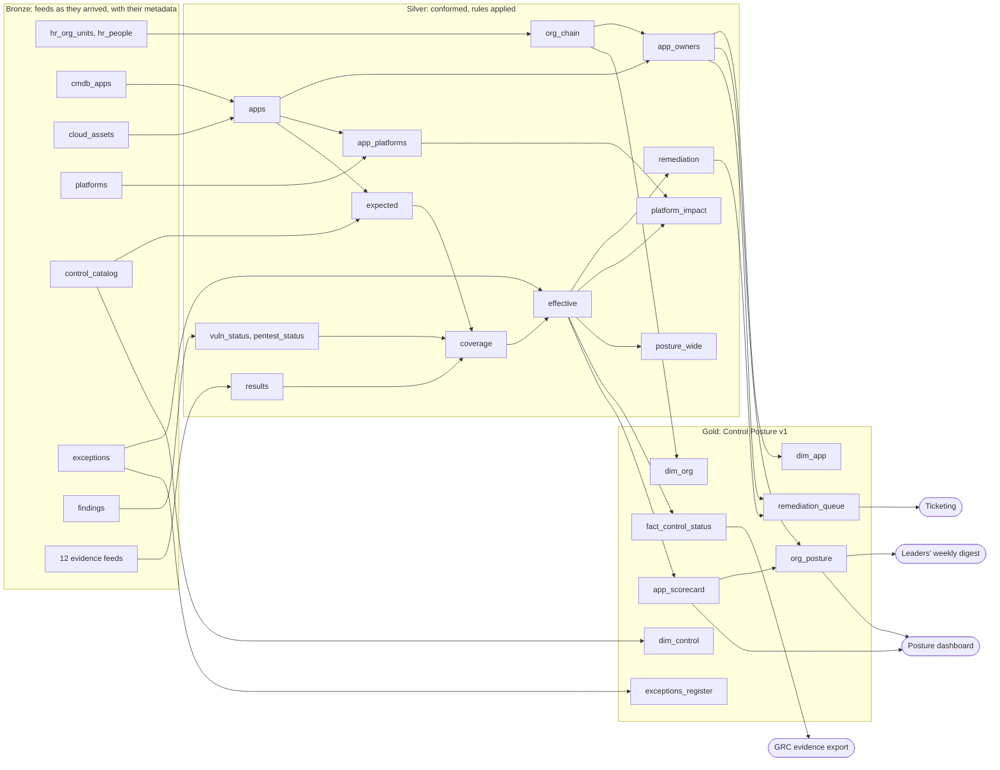

# ADR 0020: The estate as a company: an organisation, shared infrastructure, and a real bronze, silver and gold

- **Status:** proposed, 2026-11-12 (Q-169 to Q-175 open: the maintainers' to decide before it is built)
- **Date:** 2026-11-12
- **Builds on:**
  - [ADR 0013 §8](0013-discovered-checks.md): the control estate.
  - [ADR 0014](0014-gates.md): the gates and the estate's answer key.
  - [ADR 0015](0015-the-bronze-layer.md): the bronze layer. Amendments 3 to 5 cover checks explained for any dataset,
    the silver layer, and the bronze tables' metadata.

## Context

The maintainer, 2026-11-12, after the silver layer's What happened tab (ADR 0015 amendment 4): *the example doesn't
really follow a bronze, silver, gold pattern. The silver layer is super basic and doesn't seem to do anything, and the
gold layer doesn't feel like a finalised schema a product would consume.* They asked for organisations and leadership
chains, more applications, controls that interact behind the scenes, and a deep think on making the example
meaningful.

They are right. Today's estate (examples/control-estate/):

- **Bronze:** 600 applications in one inventory file and twelve control files, each judged well (the answer key in ADR
  0014). But it has no organisation, no people, no infrastructure, no exceptions and no findings. The only interaction
  between controls is one dependency rule and two shared-health draws in the generator (`DEPENDS`, `scanFails`).
- **Silver:** one 13-way left join that pivots the controls onto the inventory (`posture`), plus a wide `CASE` sum per
  application (`app_scores`). Nothing is conformed, deduplicated, keyed, effective-dated, or decided by rules.
- **Gold:** six small summaries (by unit, by control, by type, by profile, by control and type, failed together). They
  are useful to look at, but none is a dataset with a grain, a key, a contract and a consumer.

So the What happened tab has little to tell, and the checks never meet the failures that make data work hard: master
data that drifts, joins that orphan rows, rules that change a status without the raw data changing, shared
infrastructure that fails many things at once, and a product schema that must not break.

## Decision (proposed)

Build a new example, **the Larkspur estate** (`examples/larkspur/`, a fictional financial-services group; no real
company or person is its subject), as a real medallion pipeline. Keep the control estate as it is until Larkspur
passes its own answer key, then make Larkspur the demo (Q-169).

### 1. The world the generator models

| Entity | Size (demo) | What it adds |
|---|---|---|
| **Organisation** | 1 group → 5 segments (EVPs) → ~16 business units (SVPs) → ~48 departments (VPs) → ~180 teams (directors) | Leadership chains; roll-ups up the chain; reorgs |
| **People** | ~250 leaders, each leading one unit, some acting for a vacancy | Who is accountable; a leader leaving |
| **Applications** | ~2,400 (600 for the tests, Q-170), each owned by a team | Tier, exposure (internet, partner, internal), data class, datastore, hosting, site, platform, lifecycle (build, active, retiring, retired), created and retire-by dates; a few new each day, a few retired |
| **Platforms** | ~45: clusters, VM farms, ingresses, identity providers, key stores, backup systems, log pipelines, certificate authorities, vaults, scanners | Shared infrastructure, as a dependency graph. Every application depends on a chain of them, and a platform's trouble reaches every application above it |
| **Control catalogue** | 14 controls (12 with their own feed, 2 told in silver: the vulnerability SLA from the findings, ownership from the CMDB and HR), a 15th added mid-month | Family (NIST CSF 2.0 function), framework references (ISO 27001:2022 Annex A, PCI DSS v4.0, SOC 2), weight, cadence, applicability, dependencies, what compensates for it |
| **Exceptions** | ~1% of what applies | Risk acceptances with an approver, a reason, a compensating control, and an expiry date |
| **Findings** | ~3,000 open | Vulnerability and penetration-test findings, each with a severity, found and due dates, and closed when fixed. SLA by severity (critical 15 days, high 30) |

The behaviour behind the data, none of it known to any judge:

- **Applicability is a rule on attributes:** for example, TLS, WAF and pentest apply to internet- and partner-facing
  applications. So a change to an application's attributes (it goes internet-facing) changes what applies to it.
- **Dependencies between controls:**
  - key rotation needs encryption at rest;
  - a DR exercise needs a backup to restore;
  - privileged access needs MFA for administrators;
  - the vulnerability SLA needs the scanner's agent to be present (else no evidence).
- **Compensation and exceptions:**
  - a WAF in block mode compensates for an overdue pentest on an internet-facing application;
  - network isolation compensates for internal TLS;
  - an exception turns a failure into an accepted risk until the day it expires.
- **Shared infrastructure:**
  - an ingress's configuration sets the WAF mode for every application behind it;
  - a certificate authority's intermediate certificate serves TLS for its ingresses and log forwarding for their
    applications;
  - a site's backup controller backs up every application there;
  - a region's scanner reaches the agents there.
- **The organisation's effect:** some departments are better kept than others (a per-unit propensity). A new leader's
  remediation push shows as a steady improvement over weeks.
- **The calendar:** SLA dates cluster as today: Patch Tuesday plus the SLA days, quarter-end access reviews, fiscal
  dates for pentests and DR exercises. A quarter-end change freeze slows fixes for its last week.
- **People and handovers:** a team moved in a reorg fixes more slowly for two weeks while ownership is handed over.
- **The tools' own artefacts:** a scanner reports a finding as new when its agent is reinstalled. An export job that
  didn't run leaves yesterday's file in place.

### 2. Bronze: every feed as it arrived, with its metadata

About 19 daily files plus one fixed one. Each is a snapshot as its system would export it. Each is judged as today's
twelve are (schema, amount, blanks, values, key, scope; learned shares, shape, pairs, forest, classifier). Each
carries the bronze metadata (ADR 0015 amendment 5) and the source's own export time (`exported_at`).

| File | Grain | From |
|---|---|---|
| `hr_org_units` | an organisational unit | the HR system's daily extract: id, parent, name, level, leader, acting leader, cost centre |
| `hr_people` | a leader | id, display name, title, manager, unit, status (active, leave, left) |
| `cmdb_apps` | an application record | the CMDB's extract: the attributes above and the owning team. Its ids are not always clean |
| `cloud_assets` | an application tag in an account | the cloud inventory: account, cluster, region, assets |
| `control_catalog` | a control | the GRC tool's catalogue |
| `exceptions` | an exception | the risk register |
| `findings` | an open or recently closed finding | the scanners and pentest reports |
| `platforms` (fixed) | a platform and what it depends on | the architecture inventory |
| twelve evidence feeds | an application a control applies to | as today (certificate inventory, WAF, encryption, key rotation, backup jobs, DR exercises, MFA, access reviews, logging coverage, privileged vault, pentest schedule), plus `edr_coverage` |

A new bronze check is proposed (Q-172): **fresh**, the file isn't yesterday's again. It holds when today's file has
the same sha256 as the last load's, or its `exported_at` is older than its cadence allows. It is told from the ingest
record that amendment 5 now keeps.

### 3. Silver: the company conformed, and the rules applied

Four notebooks. Each step is a SQL cell that smaltql runs today (recursive CTEs, window functions, `string_agg`,
`EXCEPT`, `date()` and `julianday()` all work, checked 2026-11-12). Each step's What happened has something real to
say.

**The organisation** (`org.nb.ts`):
- `org_units`: typed and trimmed.
- `org_chain`: a recursive walk from every unit to the root, with a cycle guard and a depth cap. It gives each unit's
  path, depth, its segment, unit, department and team, and each level's leader. A vacant unit's leader is its acting
  leader.
- `leaders`: the people leading units.

**The applications** (`apps.nb.ts`):
- `apps_clean`: ids normalised (upper-cased, trimmed). Duplicates collapse to one record a key, the newest record
  winning (`row_number()`), and conflicting duplicates are flagged.
- `apps`: the conformed application, its attributes and platform, marked when it is in the cloud inventory.
- `app_owners`: each application joined to its owning team's chain, marked orphaned when the team doesn't resolve.
  It is kept apart from `apps` so that a problem with the organisation holds only what names an owner chain (the
  roll-ups). The per-application statuses and scorecards don't depend on it (holds reach only what is downstream,
  `together: false`).
- `shadow_assets`: cloud tags with no CMDB record.
- `app_platforms`: the recursive closure of each application's platform dependencies.

**The evidence** (`evidence.nb.ts`):
- The check steps on each feed, as today.
- `results`: every feed as one long table (application, control, raw status normalised, evidence time, due date,
  detail).
- `vuln_status` and `pentest_status`: told from the findings ledger by severity SLA, not taken from a scanner's own
  verdict. A finding seen again after an agent is reinstalled keeps its earliest first-found date (one finding an asset
  and CVE), so its SLA clock doesn't start over.

**The posture** (`posture.nb.ts`):
- `expected`: what applies, applications by the catalogue's rules, as of the day.
- `coverage`: expected against results. It gives evidence present, evidence missing (no data, not a failure), and
  results for something that doesn't apply.
- `effective`: the status a person reads, from the raw status, an exception active that day, a compensating control,
  a failed dependency, and the derived `ownership` control (an active application whose owner chain resolves to an
  active leader). It gives a reason for every row.
- `remediation`: what is failing, with its SLA clock and its owner chain.
- `platform_impact`: today's failures attributed to the platforms they share, one row a platform and control. The
  learned shares check on its platform column, against the usual share, is where a root cause is named.
- `posture_wide`: one row an application, a column a control's effective status, as today's `posture`. It is what the
  pairs, the forest and the classifier read, since they compare columns within a row.

**Silver's gates and rules:**
- **reconcile:** one application a key; one result an application and control; effective rows equal expected rows.
- **The check steps' rules:** every active application has an owner chain (`app_owners`); the organisation has no
  cycle (`org_chain`'s walk didn't reach its depth cap).
- **needs:** key rotation needs encryption.
- **scope:** results only for what applies.
- **Learned:** watched on `posture_wide` (shares, pairs, forest, classifier), `platform_impact` (shares) and
  `effective`.

### 4. Gold: a data product with a contract, and who consumes it

`product.nb.ts` publishes **Control Posture v1**, a star schema with a grain, a key and a contract on every dataset,
and named consumers.

| Dataset | Grain (key) | What is in it | Consumed by |
|---|---|---|---|
| `dim_org` | an organisational unit (`org_unit_id`) | name, level, path, leader, the unit at each level and its leader | every roll-up |
| `dim_app` | an application (`app_id`) | its attributes, owner unit, owner chain, platform, lifecycle | the posture dashboard |
| `dim_control` | a control (`control_id`) | family, framework references, weight, cadence | the GRC evidence export |
| `fact_control_status` | an application and control (`app_id`, `control_id`) | effective and raw status, reason, days overdue, exception, platform, `as_of` | the GRC evidence export, the auditors |
| `app_scorecard` | an application (`app_id`) | a weighted score from 0 to 100 and a grade. Excepted controls are left out of the score; compensated ones count three quarters; a missing evidence is said, not scored. Also: failing controls, overdue items, exceptions expiring within 30 days, the owning team (its chain is `dim_app`'s) | the posture dashboard, the owners |
| `org_posture` | an organisational unit (`org_unit_id`) | for every unit at every level, over all the applications beneath it: applications, critical applications, the tier-weighted score, failing critical applications, overdue items, exceptions expiring, the share with no evidence | the leaders' weekly digest, the posture dashboard |
| `exceptions_register` | an exception (`exception_id`) | the application, the control, the approver, the expiry, days left, and active, expiring or expired | the risk committee |
| `remediation_queue` | an item (`app_id`, `control_id`) | what is failing, the owner unit and leader, the due date, days overdue, severity, platform | ticketing |

**Gold's gates:**
- **schema:** the contract.
- **rules:**
  - statuses in the vocabulary;
  - `as_of` is the day;
  - a score from 0 to 100;
  - the group's applications in `org_posture` equal `dim_app`'s rows.
- **reconcile:**
  - the fact's rows are silver's expected rows;
  - the root unit's applications equal `dim_app`'s rows;
  - one scorecard an application.
- **The seal**, as today.

A contract declared on a published dataset (columns, types, nullability, accepted values, grain, description,
version, consumers) is a new document field (Q-171). Until it is decided, the schema check compares against the
dataset's declared columns, as the data list's are today.

### The flow at a glance

### 5. What happens in March: the answer key, layer by layer

The calm days publish and seal. Each planted day exercises one capability at the layer where a real team would want
it caught. Days marked *look-alike* must publish. A planted day is fixed only when its row of this table passes
through the engine (Q-169), as ADR 0014's is today.

| Day | Planted | Layer, gate, check | What should be said |
|---|---|---|---|
| Mon 4 | The MFA feed arrives empty | bronze `mfa`, amount | holds: no rows |
| Tue 5 | The vulnerability scanner's upgrade writes statuses and severities in capitals | bronze `findings`, values (learned) | warns: new values. Silver normalises them, so silver and gold are calm. The layering, shown |
| Wed 6 | The backup feed is yesterday's file again | bronze `backup_jobs`, fresh (Q-172) | holds: the same bytes as Tue 5's file, exported Tue 5 |
| Thu 7 | The logging feed lacks a column | bronze `logging_coverage`, schema | holds: 4 of 5 columns |
| Sat 9 | An agent reinstall on cluster `eks-prod-4` makes the scanner report 300 open findings as found today | bronze `findings`, shape (learned); silver `vuln_status` | warns at bronze: first-found dates much younger than usual. Silver keeps each finding's earliest date, so nothing becomes less overdue. Silver and gold are calm. An improvement that isn't, seen through |
| Fri 8 | Key rotation passes where encryption fails | silver `effective`, needs | holds the posture: N pass key rotation while failing encryption |
| Mon 11 | *Look-alike:* a reorg moves seven teams (~210 applications) from one VP to another | gold `org_posture`, learned | warns for the two VPs. The story says it follows the reorg (Q-173). Publishes |
| Tue 12 | A configuration push puts ingress `ing-east-3`'s WAF in monitor mode | bronze `waf`, values (band); silver `platform_impact` | holds. The story leads with the platform: 92% of today's WAF failures are behind `ing-east-3` |
| Wed 13 | WAF rows for applications that aren't internet-facing | bronze `waf`, scope | holds: rows out of scope |
| Thu 14, Fri 15 | *Look-alike:* findings due after Patch Tuesday, and half the pentests due | silver `vuln_status`, due; bronze `pentest_schedule`, due | notes: the usual lateness. Publishes |
| Fri 15 | 46 annual exceptions expire unrenewed | silver `effective`, shares (learned) | warns: 46 failures with no change in the raw data, because their exceptions expired today. The remediation queue grows. Publishes |
| Mon 18 | The HR extract drops a dissolved department without reassigning its teams | silver `app_owners`, the rule (owner chain); What happened | holds the roll-ups: 138 of 2,400 applications found no match in the organisation. The per-application statuses and scorecards publish |
| Tue 19 | Site DC-East's backup controller is down | bronze `backup_jobs`, values (band on not assessed); silver `platform_impact` | holds. The story names `bkp-dc-east` |
| Wed 20 | A CMDB sync writes 60 duplicates (lower-cased ids, trailing spaces), 12 with another owner | silver `apps_clean`, What happened; needs (conflicts) | 2,460 records in, 2,400 out. Warns: 12 applications with two owners, the newest kept. Publishes |
| Thu 21 | TLS rows twice | bronze `tls`, amount and key | holds |
| Fri 22 | Six in ten DR exercises late | bronze `dr_exercises`, due | holds: the one SLA day that is real |
| Mon 25 | Certificate authority `ca-int-2`'s intermediate expires behind `ing-west-1`: TLS fails, and so does log forwarding for the same applications | silver `effective`, pairs; forest; silver `platform_impact` | Each control's rise alone is modest; together they are not. Warns: TLS and logging failing together, behind `ca-int-2` |
| Tue 26 | No TLS rows for one business unit's internet-facing applications | bronze `tls`, scope | holds: in-scope applications with no row |
| Wed 27 | The catalogue adds an SBOM control with no feed yet | silver `coverage`; gold `org_posture` | Missing evidence, said as no data and not as failing (the missing-data convention, now at gold). Scores leave it out, with a note. Publishes |
| Thu 28 | An HR error makes a VP report to one of their own directors | silver `org_chain`, the rule (no cycle) | holds the roll-ups: a leadership chain loops. Names both people's units |
| Fri 29 | *Look-alike:* quarter-end access reviews | bronze `access_reviews`, due | notes. Publishes |
| Mon 25 to Sun 31 | *Look-alike:* the quarter-end change freeze. Fewer fixes ship, so overdue items creep up across every unit | gold `remediation_queue`, `org_posture` | notes: the freeze. Publishes |
| all month | A new SVP's remediation push: their units improve steadily. The teams moved on Mon 11 also fix more slowly for two weeks, a handover | gold `org_posture`, learned | warns as above usual until the new level is accepted (Q-57's Accept the new level). The handover dip is said as following the reorg |

### 6. What the tool needs that it doesn't have

The example is built with the tool as it stands wherever it can. Four additions are proposed, each the maintainers' to
decide:

- **Gold contracts** (Q-171): a published dataset's declared contract, checked by gold's schema check and shown on a
  Contract tab. Adding a document field moves plan hashes only for flows that declare one.
- **`fresh`** (Q-172): a check name in the vocabulary (plan/4), told from the ingest record.
- **Attribution through silver** (Q-173): a gold change said as following a silver change (the reorg moved these
  applications). It extends `StoryOptions.upstream` from sources to steps.
- **A product view** (Q-174): the posture dashboard over gold in the app (the organisation as a tree, a leader's
  roll-up, a team's scorecards), so the demo shows the data product being consumed and not only built.

### 7. Scale and the first load

At 2,400 applications a day's files hold about 25,000 rows (about 1.8 MB of CSV, a few hundred KB compressed). A
month is about 55 MB on the static host, fetched a day at a time. Learned checks watch the evidence feeds, the CMDB,
the HR extract and silver's `effective` and `platform_impact`, with six months of history. Histories are built on the
runner in parallel and cached as today (ADR 0019).

The first day's budget is 5 s on the machine ADR 0019 measured. It will be measured once slice 3 is built. The tests
run on 600 applications (Q-170).

### 8. The slices

1. **The generator:**
   - the organisation, people, applications, platforms, catalogue, exceptions, findings and cloud assets;
   - calm days only;
   - `test/fixtures/larkspur.ts` and a test of the data's facts: hierarchy integrity, applicability, the dependency
     graph, rates.
2. **Bronze:** the feeds, their ontology (object types for the organisational unit, the person, the application, the
   platform and the control, with their links), their checks, the bronze metadata, `fresh` if decided, and the bronze
   days of the answer key.
3. **Silver:** the four notebooks, their gates, and the silver days.
4. **Gold:** Control Posture v1, its contracts if decided, its gates and the seal, and the gold days.
5. **The answer key through the engine:** `test/larkspur-flow.test.ts` (slow set), the histories, the app build and
   the browser stops.
6. **The product view**, if decided.
7. **The switch:** Larkspur becomes the demo. The control estate stays as a regression, or is retired (Q-169).

## Consequences

- **The demo can show what each layer is for:**
  - bronze catches what is wrong with a file;
  - silver catches what goes wrong when files meet (orphans, duplicates, expired exceptions, loops) and names a root
    cause (`platform_impact`);
  - gold catches what would break a consumer;
  - the models catch interactions no single check sees.
- The What happened tab gets real stories: duplicates collapsed, orphans with no match, rows multiplied by a join and
  why.
- Every number on screen has a usual to compare with, and missing evidence is never a failure.
- The example is larger. The first load and the history build must be re-measured, and the budgets in §7 kept or
  revised.
- ADR 0014's answer key stays the control estate's. Larkspur's is new, and a planted day that moves is a decision, not
  a fix.

## Open questions

- **Q-169:** a new example (`examples/larkspur/`) beside the control estate, made the demo once its answer key passes;
  or the control estate evolved in place (its answer key moves).
- **Q-170:** scale: 2,400 applications for the demo, 600 for the tests?
- **Q-171:** gold contracts as a document field, and a Contract tab.
- **Q-172:** the `fresh` check.
- **Q-173:** attribution through silver steps.
- **Q-174:** a product view (the posture dashboard) over gold in the app.
- **Q-175:** fictional names: the company and people are generated from neutral word lists; product names for
  platforms (an IdP, a SIEM) stay generic as today's do (okta, splunk).
