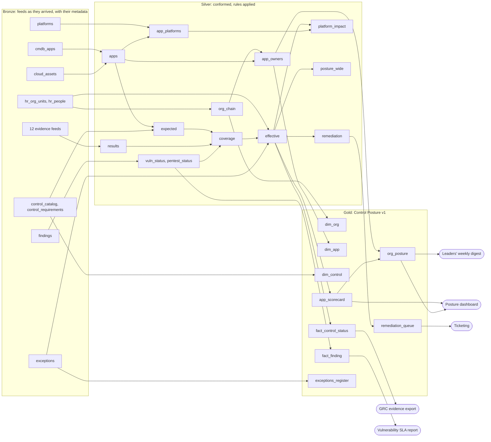

# ADR 0020: The estate as a company: an organisation, shared infrastructure, and a real bronze, silver and gold

- **Status:** accepted, 2026-11-12: the maintainer took the recommended answer to each of Q-169 to Q-175
  (docs/OPEN_QUESTIONS.md). It is built in the slices of §8.
- **Date:** 2026-11-12
- **Builds on:**
  - [ADR 0013 §8](0013-discovered-checks.md): the control estate.
  - [ADR 0014](0014-gates.md): the gates and the estate's answer key.
  - [ADR 0015](0015-the-bronze-layer.md): the bronze layer. Amendments 3 to 5 cover checks explained for any dataset,
    the silver layer, and the bronze tables' metadata.

## Context

The maintainer, 2026-11-12, after the silver layer's What happened tab (ADR 0015 amendment 4): *the example doesn't
really follow a bronze, silver, gold pattern. The silver layer is super basic and doesn't seem to do anything, and the
gold layer doesn't feel like a finalised schema a product would consume.* They asked for organisations and leadership
chains, more applications, controls that interact behind the scenes, and a deep think on making the example
meaningful.

They are right. Today's estate (examples/control-estate/):

- **Bronze:** 600 applications in one inventory file and twelve control files, each judged well (the answer key in ADR
  0014). But it has no organisation, no people, no infrastructure, no exceptions and no findings. The only interaction
  between controls is one dependency rule and two shared-health draws in the generator (`DEPENDS`, `scanFails`).
- **Silver:** one 13-way left join that pivots the controls onto the inventory (`posture`), plus a wide `CASE` sum per
  application (`app_scores`). Nothing is conformed, deduplicated, keyed, effective-dated, or decided by rules.
- **Gold:** six small summaries (by unit, by control, by type, by profile, by control and type, failed together). They
  are useful to look at, but none is a dataset with a grain, a key, a contract and a consumer.

So the What happened tab has little to tell, and the checks never meet the failures that make data work hard: master
data that drifts, joins that orphan rows, rules that change a status without the raw data changing, shared
infrastructure that fails many things at once, and a product schema that must not break.

## Decision

Build a new example, **the Larkspur estate** (`examples/larkspur/`, a fictional financial-services group; no real
company or person is its subject), as a real medallion pipeline. Keep the control estate as it is until Larkspur
passes its own answer key, then make Larkspur the demo (Q-169).

### 1. The world the generator models

| Entity | Size (demo) | What it adds |
|---|---|---|
| **Organisation** | 1 group → 5 segments (EVPs) → ~16 business units (SVPs) → ~48 departments (VPs) → ~180 teams (directors) | Leadership chains; roll-ups up the chain; reorgs |
| **People** | ~250 leaders, each leading one unit, some acting for a vacancy | Who is accountable; a leader leaving |
| **Applications** | ~2,400 (600 for the tests, Q-170), each owned by a team | Tier, exposure (internet, partner, internal), data class, datastore, hosting, site, platform, lifecycle (build, active, retiring, retired), created and retire-by dates; a few new each day, a few retired |
| **Platforms** | ~45: clusters, VM farms, ingresses, identity providers, key stores, backup systems, log pipelines, certificate authorities, vaults, scanners | Shared infrastructure, as a dependency graph. Every application depends on a chain of them, and a platform's trouble reaches every application above it. A platform can also provide a control that its applications inherit (§10) |
| **Control catalogue** | 14 controls (12 with their own feed, 2 told in silver: the vulnerability SLA from the findings, ownership from the CMDB and HR), a 15th added mid-month | Its NIST CSF 2.0 function and category (2.0 adds Govern, where ownership sits), its framework requirements as a bridge (ISO 27001:2022 Annex A, PCI DSS v4.0.1, SOC 2's CC1 to CC9; each mapping says how the two relate, as NIST IR 8477 does), weight, cadence, applicability, dependencies, what compensates for it, and the platform that provides it, if any |
| **Exceptions** | ~1% of what applies | Risk acceptances with an approver, a reason, a compensating control, and an expiry date. One row a version, so an extension keeps the first expiry (`original_valid_to`) |
| **Findings** | ~3,000 open | Vulnerability and penetration-test findings, each with a severity, found and due dates, and a status as scanners write it (new, active, fixed, re-opened). SLA by severity (critical 15 days, high 30). The scanner also writes one informational row for each application it scanned, saying whether it logged in, so an application never scanned, or scanned without logging in, is told from a clean one |

The behaviour behind the data, none of it known to any judge:

- **Applicability is a rule on attributes:** for example, TLS, WAF and pentest apply to internet- and partner-facing
  applications. So a change to an application's attributes (it goes internet-facing) changes what applies to it.
- **Dependencies between controls:**
  - key rotation needs encryption at rest;
  - a DR exercise needs a backup to restore;
  - privileged access needs MFA for administrators;
  - the vulnerability SLA needs the scanner's agent to be present (else no evidence).
- **Compensation and exceptions:**
  - a WAF in block mode compensates for an overdue pentest on an internet-facing application;
  - a private link compensates for TLS on a partner-facing application;
  - an exception turns a failure into an accepted risk until the day it expires.
- **Shared infrastructure:** some controls are inherited, as NIST SP 800-37 allocates them. A control is *common*
  when a platform provides it (TLS ends at the ingress), *hybrid* when the two share it (logging: the pipeline and the
  application's own forwarder), and the application's own otherwise. So a platform's change reaches every application
  that inherits from it:
  - an ingress's configuration sets the WAF mode for every application behind it;
  - a certificate authority's intermediate certificate serves TLS for its ingresses and log forwarding for their
    applications;
  - a site's backup controller backs up every application there;
  - a region's scanner reaches the agents there.
- **The organisation's effect:** some departments are better kept than others (a per-unit propensity). A new leader's
  remediation push shows as a steady improvement over weeks.
- **The calendar:** SLA dates cluster as today: Patch Tuesday plus the SLA days, quarter-end access reviews, fiscal
  dates for pentests and DR exercises. A quarter-end change freeze slows fixes for its last week.
- **People and handovers:** a team moved in a reorg fixes more slowly for two weeks while ownership is handed over.
- **The tools' own artefacts:**
  - a scanner reports a finding as new when its agent is reinstalled;
  - a scanner that can't log in still scans, but finds far less, so its findings fall and read as an improvement;
  - an export job that didn't run leaves yesterday's file in place;
  - an identity provider reports a user registered for MFA whether or not a policy enforces it, so the MFA feed
    carries both, and the control passes only when MFA is enforced.

### 2. Bronze: every feed as it arrived, with its metadata

Twenty daily files and two fixed ones. Each is a snapshot as its system would export it. Each is judged as today's
twelve are (schema, amount, blanks, values, key, scope; learned shares, shape, pairs, forest, classifier). Each
carries the bronze metadata (ADR 0015 amendment 5), and its source's own export time is said beside it (`exported_at`
in the data list), never in its rows.

| File | Grain | From |
|---|---|---|
| `hr_org_units` | an organisational unit | the HR system's daily extract: id, parent, name, level, leader, acting leader, cost centre |
| `hr_people` | a leader | id, display name, title, manager, unit, status (active, leave, left) |
| `cmdb_apps` | an application record | the CMDB's extract: the attributes above and the owning team. Its ids are not always clean |
| `cloud_assets` | an application tag in an account | the cloud inventory: account, cluster, region, assets |
| `control_catalog` | a control | the GRC tool's catalogue |
| `control_requirements` | a control and a framework requirement | the GRC tool's mappings: framework, requirement, and how the two relate (subset, intersects, equal, superset) |
| `exceptions` | a version of an exception | the risk register |
| `findings` | an open or recently closed finding | the scanners and pentest reports, with one scan-information row an application scanned (`credentialed`: yes or no) |
| `platforms`, `platform_links` (fixed) | a platform; a dependency or a control a platform provides | the architecture inventory |
| twelve evidence feeds | an application a control applies to | as today (certificate inventory, WAF, encryption, key rotation, backup jobs, DR exercises, MFA, access reviews, logging coverage, privileged vault, pentest schedule), plus `edr_coverage`. `mfa` says registered and enforced apart; `edr_coverage` says when a sensor runs in reduced functionality, which isn't coverage |

A new bronze check (Q-172): **fresh**, the file isn't yesterday's again. It holds when today's file has
the same sha256 as the last load's, or its `exported_at` is older than its cadence allows. It is told from the ingest
record that amendment 5 now keeps. It reads the file's own bytes and export time, not when the file arrived: a file
that lands on time but is byte for byte yesterday's hides whatever changed since (a stale HR export hides leavers).
Like dbt's source freshness, it can warn after one age and hold after another.

### 3. Silver: the company conformed, and the rules applied

Four notebooks. Each step is a SQL cell that smaltql runs today. Recursive CTEs, window functions, `string_agg`,
`EXCEPT`, `date()` and `julianday()` all work (checked 2026-11-12); `QUALIFY`, `date_diff`, `INTERVAL` and the JSON
functions don't.

The riskiest steps were prototyped on the engine the same day:
- the walk up the leadership chain with a depth cap, which stops at the cap on a loop and marks both units;
- each level's unit and leader as columns, by conditional aggregation over the walk;
- duplicates collapsed to the newest record with `row_number()`. Owner conflicts are counted with a grouped join,
  since `count(DISTINCT …) OVER` isn't supported;
- orphans by a left join;
- every unit's roll-up over all the applications beneath it, with the walk used as a closure.

Each step's What happened has something real to say.

**The organisation** (`org.nb.ts`):
- `org_units`: typed and trimmed.
- `org_chain`: a recursive walk from every unit to the root, with a cycle guard and a depth cap. It is a closure: one
  row a unit and each unit above it, with the depth. It gives each unit's path, depth, its segment, unit, department
  and team, and each level's leader. A vacant unit's leader is its acting leader, or else the leader of the unit
  above, marked `inherited`, as HR systems inherit a vacant manager role from the parent organisation.
- `leaders`: the people leading units.

**The applications** (`apps.nb.ts`):
- `apps_clean`: ids normalised (upper-cased, trimmed). Duplicates collapse to one record a key, the newest record
  winning (`row_number()`), and conflicting duplicates are flagged.
- `apps`: the conformed application, its attributes and platform, marked when it is in the cloud inventory.
- `app_owners`: each application joined to its owning team's chain. An application whose chain doesn't resolve is
  kept, marked orphaned, under the **Unassigned** member: a missing reference points to a member that says so, never
  to a null key, and the row is never dropped (Kimball's rule). It is kept apart from `apps` so that a problem with the
  organisation holds only what reads the chain (`dim_org`, `dim_app` and the roll-ups). The per-application statuses and
  scorecards don't depend on it (holds reach only what is downstream, `together: false`). That is why the `ownership`
  control reads the team itself (it is in today's HR extract and has an active or acting leader), not the chain.
- `shadow_assets`: cloud tags with no CMDB record. Gold keeps them under the **Unregistered** application, so they
  are counted and owned by no one, visibly (CIS Safeguard 1.2 asks for unauthorised assets to be dealt with weekly).
- `app_platforms`: the recursive closure of each application's platform dependencies.

**The evidence** (`evidence.nb.ts`):
- The check steps on each feed, as today.
- `results`: every feed as one long table (application, control, raw status normalised, evidence time, due date,
  detail).
- `vuln_status` and `pentest_status`: told from the findings ledger by severity SLA, not taken from a scanner's own
  verdict. A finding seen again after an agent is reinstalled keeps its earliest first-found date (one finding an asset
  and CVE), so its SLA clock doesn't start over. An application the scanner didn't reach, or reached without
  logging in (its scan-information row), is not assessed, never clean: fewer findings count only behind an authenticated scan,
  which is why PCI DSS v4.0.1 (11.3.1.2) asks for authenticated internal scans.

**The posture** (`posture.nb.ts`):
- `expected`: what applies, applications by the catalogue's rules, as of the day.
- `coverage`: expected against results. It gives evidence present, evidence missing (no data, not a failure), and
  results for something that doesn't apply.
- `effective`: the status a person reads, from the raw status, an exception active that day, a compensating control,
  a failed dependency, the platform it inherits from, and the derived `ownership` control (an active application
  whose owning team is in today's HR extract with an active or acting leader). It gives a reason for every row:
  `exception_expired` reads differently from a regression.
- `remediation`: what is failing, with its SLA clock, its owning team and that team's leader.
- `platform_impact`: today's failures attributed to the platforms they share, one row a platform and control. The
  learned shares check on its platform column, against the usual share, is where a root cause is named.
- `posture_wide`: one row an application, a column a control's effective status, as today's `posture`. It is what the
  pairs, the forest and the classifier read, since they compare columns within a row.

**Silver's gates and rules:**
- **reconcile:** one application a key; one result an application and control; effective rows equal expected rows.
- **The check steps' rules:**
  - every active application has an owner chain: none is Unassigned (`app_owners`);
  - the organisation has no cycle (`org_chain`'s walk didn't reach its depth cap) and one root: every unit's walk
    reaches the group.
- **needs:** key rotation needs encryption.
- **scope:** results only for what applies.
- **Learned:** watched on `posture_wide` (shares, pairs, forest, classifier), `platform_impact` (shares),
  `shadow_assets` (amount) and `effective`.

### 4. Gold: a data product with a contract, and who consumes it

`product.nb.ts` publishes **Control Posture v1**, a star schema with a grain, a key and a contract on every dataset,
and named consumers: a data product that can be found, addressed, understood and trusted, with its service levels
published.

| Dataset | Grain (key) | What is in it | Consumed by |
|---|---|---|---|
| `dim_org` | an organisational unit (`org_unit_id`) | name, level, path, leader (acting or inherited, marked), the unit at each level and its leader | every roll-up |
| `dim_app` | an application (`app_id`) | its attributes, owner unit, owner chain, platform, lifecycle. Two members say what is unknown: owner **Unassigned** where the chain doesn't resolve, and the **Unregistered** application for cloud assets no CMDB record names | the posture dashboard |
| `dim_control` | a control (`control_id`) | CSF 2.0 function and category, framework requirements, weight, cadence, the platform that provides it | the GRC evidence export |
| `fact_control_status` | an application and control (`app_id`, `control_id`) | effective and raw status, reason, days overdue, exception, the platform it is inherited from, `as_of`. One row for every pair that applies, evidence or not: what didn't happen is a row (`not_assessed`), never a missing one (Kimball's coverage fact) | the GRC evidence export, the auditors |
| `fact_finding` | a finding (`finding_id`) | application, severity (critical, high, medium, low, informational), first found, due, fixed, days open, overdue. One row a finding, updated as it moves (an accumulating snapshot) | the vulnerability SLA report, the auditors |
| `app_scorecard` | an application (`app_id`) | a score from 0 to 100, its coverage beside it, and a grade (below). Also: failing controls, overdue items, exceptions expiring within 30 days, the owning team (its chain is `dim_app`'s) | the posture dashboard, the owners |
| `org_posture` | an organisational unit (`org_unit_id`) | for every unit at every level, over all the applications beneath it: applications, critical applications, the tier-weighted score and its coverage, failing critical applications, overdue items, exceptions expiring | the leaders' weekly digest, the posture dashboard |
| `exceptions_register` | an exception (`exception_id`) | the application, the control, the approver, the expiry, the first expiry and how often it was extended, days left, and active, expiring or expired | the risk committee |
| `remediation_queue` | an item (`app_id`, `control_id`) | what is failing, the owning team and its leader (read from the team, not the chain), the due date, days overdue, severity, platform | ticketing |

**The score**, as the posture tools score:
- **score:** the weighted controls passed ÷ the weighted controls with evidence. A control with no evidence is left out
  of the score, as AWS Security Hub leaves out controls with no data. Excepted controls are left out too; compensated
  ones count three quarters.
- **coverage:** the controls with evidence ÷ the controls that apply, always shown beside the score. A score is only
  as good as what it covers, and NIST SP 800-55 measures the two apart.
- **grade:** A from 90, B from 80, C from 70, D from 60, F below, as SecurityScorecard grades.

**The vocabulary:**
- **status:** `pass`, `fail` and `not_assessed`, as Security Hub's PASSED, FAILED and NOT_AVAILABLE, and this
  product's own `excepted` and `compensated`;
- **severity:** Splunk's CIM: critical, high, medium, low, informational.

**Gold's gates:**
- **schema:** the contract.
- **rules:**
  - statuses and severities in the vocabulary;
  - `as_of` is the day;
  - a score from 0 to 100;
  - every fact row's application, control and unit is in its dimension, with unknowns at Unassigned or Unregistered,
    never null;
  - the group's applications in `org_posture` equal `dim_app`'s rows.
- **reconcile:**
  - the fact's rows are silver's expected rows;
  - the root unit's applications equal `dim_app`'s rows;
  - one scorecard an application.
- **The seal**, as today.

A contract declared on a published dataset is a new document field (Q-171). Its fields follow the Open Data Contract
Standard (ODCS v3) where they fit:
- an id, a version, and a status (proposed, active, deprecated, retired);
- a description: purpose, limitations, usage;
- each column's type, whether it is required or unique, whether it is part of the key, its classification, and its
  accepted values;
- the service levels: daily, available by 07:00 UTC, kept for 13 months.

As in dbt's enforced contracts, a column renamed or retyped fails the build. A breaking change is a new major version,
published beside the old one until its deprecation date. Until the contract field is built (slice 4), the schema
check compares against the dataset's declared columns, as the data list's are today.

### The flow at a glance

### 5. What happens in March: the answer key, layer by layer

The calm days publish and seal. Each planted day exercises one capability at the layer where a real team would want
it caught. Days marked *look-alike* must publish. A planted day is fixed only when its row of this table passes
through the engine (Q-169), as ADR 0014's is today.

| Day | Planted | Layer, gate, check | What should be said |
|---|---|---|---|
| Mon 4 | The MFA feed arrives empty | bronze `mfa`, amount | holds: no rows |
| Tue 5 | The vulnerability scanner's upgrade writes statuses and severities in capitals | bronze `findings`, values (learned) | warns: new values. Silver normalises them, so silver and gold are calm. The layering, shown |
| Wed 6 | The backup feed is yesterday's file again | bronze `backup_jobs`, fresh (Q-172) | holds: the same bytes as Tue 5's file, exported Tue 5 |
| Thu 7 | The logging feed lacks a column | bronze `logging_coverage`, schema | holds: 4 of 5 columns |
| Fri 8 | Key rotation passes where encryption fails | silver `effective`, needs | holds the posture: N pass key rotation while failing encryption |
| Sat 9 | An agent reinstall on cluster `eks-prod-4` makes the scanner report 300 open findings as found today | bronze `findings`, shape (learned); silver `vuln_status` | warns at bronze: first-found dates much younger than usual. Silver keeps each finding's earliest date, so nothing becomes less overdue. Silver and gold are calm. An improvement that isn't, seen through |
| Mon 11 | *Look-alike:* a reorg moves seven teams (~210 applications) from one VP to another | gold `org_posture`, learned | warns for the two VPs. The story says it follows the reorg (Q-173). Publishes |
| Tue 12 | A configuration push puts ingress `ing-east-3`'s WAF in monitor mode | bronze `waf`, values (band); silver `platform_impact` | holds. The story leads with the platform: 92% of today's WAF failures are behind `ing-east-3` |
| Wed 13 | WAF rows for applications that aren't internet-facing | bronze `waf`, scope | holds: rows out of scope |
| Thu 14, Fri 15 | *Look-alike:* the high findings from February's Patch Tuesday (Tue 13 Feb) fall due 30 days later, and half the pentests fall due | silver `vuln_status`, due; bronze `pentest_schedule`, due | notes: the usual lateness. Publishes |
| Fri 15 | 46 annual exceptions expire unrenewed; six of them had been extended once already | silver `effective`, shares (learned) | warns: 46 failures with no change in the raw data, because their exceptions expired today (reason `exception_expired`, not a regression). The remediation queue grows. Publishes |
| Sat 16, Sun 17 | A weekend password rotation isn't given to `scn-dc-west`, site DC-West's scanner: it can't log in to 120 applications' hosts, and their open findings fall 70% | bronze `findings`, shares by scanner (learned); silver `vuln_status` | warns at bronze: findings from `scn-dc-west` fell by 70% overnight, far below their usual share. Silver says the 120 are not assessed (the scanner couldn't log in), not clean. Gold's scores leave the control out for them, and coverage beside each score falls. An improvement that isn't, seen through. Publishes |
| Mon 18 | The HR extract drops a dissolved department without reassigning its teams | silver `org_chain`, the rule (one root); `app_owners`, the rule (owner chain) and What happened | holds what reads the chain (`dim_org`, `dim_app`, `org_posture`): four teams no longer reach the group, so 138 of 2,400 applications are Unassigned. The story leads with the organisation and the applications follow. The per-application statuses and scorecards publish: `ownership` reads the teams, which are still there |
| Tue 19 | Site DC-East's backup controller is down | bronze `backup_jobs`, values (band on not assessed); silver `platform_impact` | holds. The story names `bkp-dc-east` |
| Wed 20 | A CMDB sync writes 60 duplicates (lower-cased ids, trailing spaces), 12 with another owner | silver `apps_clean`, What happened; needs (conflicts) | 2,460 records in, 2,400 out. Warns: 12 applications with two owners, the newest kept. Publishes |
| Thu 21 | TLS rows twice | bronze `tls`, amount and key | holds |
| Fri 22 | Six in ten DR exercises late | bronze `dr_exercises`, due | holds: the one SLA day that is real |
| Sat 23 | A team's new cloud account brings 140 resources tagged with an application id the CMDB doesn't have | silver `shadow_assets`, amount (learned) | warns: 140 cloud resources for an application nobody registered. Gold counts them under Unregistered, owned by no one. Shadow IT is true data, so it publishes |
| Mon 25 | Certificate authority `ca-int-2`'s intermediate expires behind `ing-west-1`: TLS fails, and so does log forwarding for the same applications | silver `effective`, pairs; forest; silver `platform_impact` | Each control's rise alone is modest; together they are not. Warns: TLS and logging failing together, behind `ca-int-2` |
| Tue 26 | No TLS rows for one business unit's internet-facing applications | bronze `tls`, scope | holds: in-scope applications with no row |
| Wed 27 | The catalogue adds an SBOM control with no feed yet | silver `coverage`; gold `org_posture` | Missing evidence, said as no data and not as failing (the missing-data convention, now at gold). Scores leave it out, with a note. Publishes |
| Thu 28 | An HR error makes a VP report to one of their own directors | silver `org_chain`, the rules (no cycle, one root) | holds what reads the chain (`dim_org`, `dim_app`, `org_posture`): a leadership chain loops, and the units in the loop no longer reach the group. Names both people's units |
| Fri 29 | *Look-alike:* quarter-end access reviews | bronze `access_reviews`, due | notes. Publishes |
| Mon 25 to Sun 31 | *Look-alike:* the quarter-end change freeze. Fewer fixes ship, so overdue items creep up across every unit | gold `remediation_queue`, `org_posture` | notes: the freeze. Publishes |
| all month | A new SVP's remediation push: their units improve steadily. The teams moved on Mon 11 also fix more slowly for two weeks, a handover | gold `org_posture`, learned | warns as above usual until the new level is accepted (Q-57's Accept the new level). The handover dip is said as following the reorg |

The month is March 2024, the estate's month. Its calendar has three real dates:
- Patch Tuesday is Tue 12;
- US daylight saving time starts on Sun 10;
- Good Friday, Fri 29, is the quarter's last weekday: markets are closed, the group's offices are open.

**Alternates**, each with a real counterpart, kept for a later month:
- **A daylight-saving seam:** the EDR export writes `last_seen` in local time with no offset. Sun 10 has 23 hours, so
  a seen-in-the-last-24-hours rule on local times drops about one host in 24 (4%) that checked in on time. Catching
  it as a format error needs a written pattern rule, which `ontology.rules` doesn't have yet.
- **An identity-provider policy change:** a conditional-access edit exempts a pilot group. MFA enforcement fails for
  31 applications behind one IdP while registration is unchanged.
- **An EDR update:** 15% of sensors fall into reduced functionality mode. Silver counts them as not covered.
- **A stale HR export:** the people extract is byte for byte Tuesday's for three days and hides nine leavers. A
  second `fresh` day, with consequences that reach `ownership`.

### 6. What the tool needs that it doesn't have

The example is built with the tool as it stands wherever it can. Four additions were proposed, and the maintainer
accepted all four:

- **Gold contracts** (Q-171): a published dataset's declared contract, with ODCS v3's fields where they fit (§4),
  checked by gold's schema check and shown on a Contract tab. Adding a document field moves plan hashes only for
  flows that declare one.
- **`fresh`** (Q-172): a check name in the vocabulary (plan/4), told from the ingest record.
- **Attribution through silver** (Q-173): a gold change said as following a silver change (the reorg moved these
  applications). It extends `StoryOptions.upstream` from sources to steps.
- **A product view** (Q-174): the posture dashboard over gold in the app (the organisation as a tree, a leader's
  roll-up, a team's scorecards), so the demo shows the data product being consumed and not only built.

### 7. Scale and the first load

At about 2,400 applications a day's files hold about 28,000 rows: about 2 MB of CSV, about 330 KB compressed (measured
with slice 1). March is 61 MB on the static host, fetched a day at a time. Learned checks watch the evidence feeds, the
findings, the CMDB, the HR extract and silver's `effective`, `platform_impact` and `shadow_assets`, with six months of
history. Histories are built on the runner in parallel and cached as today (ADR 0019).

The first day's budget is 5 s on the machine ADR 0019 measured. It will be measured once slice 3 is built. The tests
run on 600 applications (Q-170).

### 8. The slices

1. **The generator** (built, see As built):
   - the organisation, people, applications, platforms, catalogue, exceptions, findings and cloud assets;
   - calm days only;
   - `test/fixtures/larkspur.ts` and a test of the data's facts: hierarchy integrity, applicability, the dependency
     graph, rates.
2. **Bronze:** the feeds, their ontology (object types for the organisational unit, the person, the application, the
   platform and the control, with their links), their checks, the bronze metadata, `fresh`, and the bronze days of the
   answer key.
3. **Silver:** the four notebooks, their gates, and the silver days.
4. **Gold:** Control Posture v1, its contracts, its gates and the seal, and the gold days.
5. **The answer key through the engine:** `test/larkspur-flow.test.ts` (slow set), the histories, the app build and
   the browser stops.
6. **The product view** (Q-174).
7. **The switch:** Larkspur becomes the demo. The control estate stays as a regression (Q-169).

### 9. Three walks through the demo

Each walk starts where a person would and ends at what they would do. Each crosses all three layers.

1. **Tue 12: a platform, not a hundred applications.**
   - The day strip shows Tue 12 held. The WAF card's Quality tab says three in five fail, outside the band.
   - Silver's `platform_impact` What happened names `ing-east-3` behind 92% of the failures.
   - Gold's `org_posture` shows which leaders' units sit behind that ingress.
   - The remediation queue has one row a failing application, each with its owning team and leader.
   - The fix is one configuration change, and the decision is recorded.
2. **Mon 18: the join that lost 138 applications.**
   - Bronze is clean: every file arrived well formed.
   - Silver's `org_chain` says four teams no longer reach the group: their department was dissolved and they weren't
     moved.
   - `app_owners`' What happened shows what follows: 138 applications found no owner chain, all from that department,
     as a picture of rows in and out. They are kept under Unassigned, not dropped.
   - The roll-ups hold; the per-application scorecards publish.
   - The fix is a reassignment in the HR system. Tomorrow's extract carries it, and the roll-ups publish again.
3. **Mon 25: two modest rises that are one cause.**
   - The TLS and logging cards each show a rise within reason.
   - The models say the two fail together far beyond what their shares explain.
   - `platform_impact` names `ca-int-2`.
   - The story leads with the certificate authority, the two controls follow from it, and its picture shows both on
     the same applications.

### 10. Grounding: what the design borrows from practice

Each part of the design follows a documented practice or a documented failure. The sources were read on 2026-11-12.
The session's network blocks a few vendor sites (AWS, Qualys, Tenable's developer pages), so those facts come from
search excerpts of the pages and are marked *(excerpt)*. A blog or a page hosted by someone other than the author is
marked *(secondary)*. Vendors' column layouts are borrowed as formats only: every name in the data is fictional
(Q-175).

**The feeds look like real exports:**
- **The CMDB:** ServiceNow's business application, with its owners, managed-by group, criticality, install type and
  [life-cycle stage](https://www.servicenow.com/docs/r/servicenow-platform/common-service-data-model-csdm/csdm-life-cycle-standard-values.html).
- **HR:** Workday's supervisory organisations, where a manager role is
  [assigned or inherited](https://doc.workday.com/admin-guide/en-us/human-capital-management/staffing/organization-assignments/deb1423870942831.html)
  from the parent organisation, as it is when the position is vacant.
- **The cloud inventory:** AWS Config's
  [configuration items](https://docs.aws.amazon.com/config/latest/developerguide/config-item-table.html)
  *(excerpt)* and Azure Resource Graph's
  [resources](https://learn.microsoft.com/azure/governance/resource-graph/concepts/query-language): resource, type,
  region, tags.
- **The findings:** Qualys's [statuses](https://docs.qualys.com/en/vm/latest/scans/vulnerability_status.htm)
  *(excerpt)* (New, Active, Fixed, Re-Opened) and Tenable's
  [states](https://developer.tenable.com/docs/refine-vulnerability-export-requests) *(excerpt)* (OPEN, REOPENED, FIXED).
- **Certificates:** AWS Certificate Manager's
  [detail](https://docs.aws.amazon.com/acm/latest/APIReference/API_CertificateDetail.html) *(excerpt)*: not before,
  not after, the issuer, what uses it.
- **MFA:** Microsoft Graph's
  [registration details](https://learn.microsoft.com/en-us/graph/api/resources/userregistrationdetails) say whether
  a user is registered, which isn't whether MFA is enforced.
- **Backups:** AWS Backup's [job states](https://docs.aws.amazon.com/aws-backup/latest/devguide/API_BackupJob.html)
  *(excerpt)*, where a job can complete with issues.
- **Logging:** agent [heartbeats](https://learn.microsoft.com/azure/azure-monitor/reference/tables/Heartbeat). A host
  whose last heartbeat is older than the threshold is silent.
- **Exceptions:** ServiceNow's
  [policy exceptions](https://www.servicenow.com/docs/r/Z61H6JNUJXKe8NNPQzK7MQ/bdkL005ccZhD85G3OGTekA) keep the
  original valid-to date once an extension is approved.

**The catalogue uses the frameworks' own shapes:**
- [NIST CSF 2.0](https://nvlpubs.nist.gov/nistpubs/CSWP/NIST.CSWP.29.pdf): six functions (Govern is new), 22
  categories, 106 subcategories.
- ISO/IEC 27001:2022 Annex A: [93 controls](https://secureframe.com/blog/iso-27001-controls) in four themes
  *(secondary)*.
- PCI DSS v4.0.1 *(secondary,
  [TrustedSec](https://trustedsec.com/blog/pci-dss-vulnerability-management-the-most-misunderstood-requirement-part-3))*:
  - 6.3.3, critical patches within a month;
  - 7.2.4, accounts reviewed every six months;
  - 11.3.1.2, internal scans authenticated.
- SOC 2's [common criteria](https://secureframe.com/hub/soc-2/common-criteria), CC1 to CC9 *(secondary)*.
- NIST IR 8477's
  [set-theory relationships](https://content.securecontrolsframework.com/pdf/scf-set-theory-relationship-mapping.pdf)
  *(secondary)* for mapping a control to a requirement: subset of, intersects with, equal, superset of.

**The interactions and the score:**
- **Inherited controls:** [NIST SP 800-37 Rev. 2](https://csrc.nist.gov/pubs/sp/800/37/r2/final) allocates every
  control as common, hybrid or system-specific.
- **Compensating controls:** under PCI DSS a compensating control
  [meets the requirement's intent](https://www.securetrust.com/compensating-control-requirements-for-pci/)
  *(secondary)*, goes beyond the other requirements, and is reviewed every year.
- **The score:** AWS Security Hub's
  [score](https://docs.aws.amazon.com/securityhub/latest/userguide/standards-security-score.html) *(excerpt)* is
  the controls passed ÷ the enabled controls with data (168 passed, 22 failed: 88%). Defender for Cloud
  [leaves out](https://learn.microsoft.com/azure/defender-for-cloud/secure-score-security-controls) a control with
  nothing assessed.
- **Coverage apart from effectiveness:** [NIST SP 800-55](https://csrc.nist.gov/pubs/sp/800/55/v1/final) measures
  implementation and effectiveness separately.
- **Grades:** SecurityScorecard's
  [A (90 and over) to F (under 60)](https://www.somerfordassociates.com/wp-content/uploads/2024/01/SecurityScorecard-Whitepaper-Scoring-Methodology.pdf)
  *(secondary)*.
- **The roll-up:**
  - a [closure table](https://www.percona.com/blog/moving-subtrees-in-closure-table/) holds every unit and each unit
    above it, with the depth;
  - Kimball's
    [bridge](https://www.kimballgroup.com/data-warehouse-business-intelligence-resources/kimball-techniques/dimensional-modeling-techniques/ragged-variable-depth-hierarchy/)
    does the same for a ragged hierarchy;
  - PostgreSQL's [`CYCLE`](https://www.postgresql.org/docs/18/queries-with.html) clause stops a walk at a loop.
    `org_chain` caps the depth instead, as prototyped on smaltql (§3).

**The product:**
- **The contract:** the Open Data Contract Standard v3:
  [fundamentals](https://bitol-io.github.io/open-data-contract-standard/v3.1.0/fundamentals/),
  [schema](https://bitol-io.github.io/open-data-contract-standard/latest/schema/) and
  [service levels](https://bitol-io.github.io/open-data-contract-standard/v3.1.0/service-level-agreement/).
- **dbt:**
  - [enforced contracts](https://docs.getdbt.com/docs/mesh/govern/model-contracts): every column's name and type
    match;
  - [versions](https://docs.getdbt.com/docs/mesh/govern/model-versions) with deprecation dates;
  - [tests](https://docs.getdbt.com/reference/data-test-configs) at warn or error;
  - [source freshness](https://docs.getdbt.com/reference/resource-properties/freshness), the model for `fresh`.
- **A data product:** [Fowler's properties](https://martinfowler.com/articles/designing-data-products.html):
  discoverable, addressable, understandable, trustworthy, natively accessible, interoperable, valuable on its own,
  secure.
- **Kimball:**
  - the [coverage fact](https://www.kimballgroup.com/data-warehouse-business-intelligence-resources/kimball-techniques/dimensional-modeling-techniques/factless-fact-table/),
    which tells what didn't happen;
  - the [member that says unknown](https://www.kimballgroup.com/2003/02/design-tip-43-dealing-with-nulls-in-the-dimensional-model/)
    in place of a null key.
- **Vocabularies:** AWS Security Hub's
  [control statuses](https://docs.aws.amazon.com/securityhub/latest/userguide/controls-overall-status.html)
  *(excerpt)* and Splunk's CIM
  [severities](https://help.splunk.com/en/splunk-cloud-platform/common-information-model/8.8/data-models/vulnerabilities).

**The planted days have real counterparts:**

| Day | What happened somewhere real |
|---|---|
| Thu 7, a column short | CrowdStrike's [Channel File 291](https://crowdstrike.com/wp-content/uploads/2024/08/Channel-File-291-Incident-Root-Cause-Analysis-08.06.2024.pdf), 2024: a content update gave 20 inputs where 21 were expected |
| Tue 12, a WAF push | Cloudflare's [outage of 2 July 2019](https://blog.cloudflare.com/details-of-the-cloudflare-outage-on-july-2-2019): one WAF rule, pushed everywhere at once |
| Thu 14, findings due | [Patch Tuesday](https://www.techrepublic.com/article/insiders-guide-to-managing-microsoft-patch-tuesday/) is a month's second Tuesday *(secondary)* |
| Fri 15, exceptions expire | ServiceNow's policy exceptions, with valid-to and extension dates (above) |
| Sat 16, Sun 17, the scanner can't log in | Tenable's [plugin 21745](https://tenable.com/plugins/nessus/21745), local checks not run; PCI DSS 11.3.1.2 |
| Mon 18, a department dropped | Entra's HR provisioning [sets a manager](https://learn.microsoft.com/en-us/azure/active-directory/app-provisioning/hr-manager-update-issues) only when the manager is processed first |
| Tue 19, one site's backups | OVHcloud's [SBG2 fire](https://datacenterdynamics.com/en/news/ovhcloud-ordered-to-pay-250k-to-two-customers-who-lost-data-in-strasbourg-data-center-fire), 10 March 2021, destroyed backups kept in the same building |
| Wed 20, CMDB duplicates | ServiceNow's [CMDB health](https://www.servicenow.com/docs/r/q4dSP2Icgr1SFv5wanVXvQ/tdVXhIuanyw2LQQ83HcODw): duplicates, orphans and staleness |
| Thu 21, rows twice | Cloudflare's [outage of 18 November 2025](https://www.ilert.com/postmortems/cloudflare-global-outage-nov-2025) *(secondary)*: a permissions change made a query return its rows twice, and the file it wrote doubled past a limit |
| Sat 23, shadow IT | CIS Controls v8's [Safeguards 1.2 and 1.3](https://cas.docs.cisecurity.org/en/latest/source/Controls1/): unauthorised assets dealt with weekly, discovery daily; CISA's [BOD 23-01](https://www.cisa.gov/binding-operational-directive-23-01): asset discovery every 7 days |
| Mon 25, a CA's intermediate | Equifax: an expired certificate left a traffic-inspection device [blind for 19 months](https://www.bankinfosecurity.com/equifax-breach-entirely-preventable-house-report-finds-a-11832) *(secondary, on the House report)*; the AddTrust root's [expiry](https://www.cmu.edu/iso/service/cert-auth/addtrust.html) in 2020 broke clients on its chains |
| Thu 28, a loop in the organisation | HR tools refuse a [cyclic organisation tree](https://help.lattice.com/hc/en-us/articles/9809709979671-Upload-Error-CyclicOrgTreeError) on upload: a loop is a known failure of organisation data |
| The IdP alternate | Azure AD's MFA [outage of 19 November 2018](https://www.theregister.com/2018/11/27/microsoft_azure_outage_postmortem/), about 14 hours while its monitors reported healthy; Okta's [2024 advisory](https://trust.okta.com/security-advisories/okta-ad-ldap-delegated-authentication-username/) on long usernames that skipped MFA |

## As built

**Slice 1, the generator (2026-11-12):** `test/fixtures/larkspur.ts`, `test/larkspur.test.ts` (31 tests, about 3 s) and
`node scripts/data/larkspur.mjs OUT_DIR`.
- **The world:** 246 units (176 teams), 46 platforms, 14 controls and 57 requirement mappings. 2,600 applications are
  drawn across the span, and about 2,400 are in the CMDB in March 2024.
- **The files:** twenty daily files and two fixed ones, about 28,000 rows and 2 MB a day. March is 61 MB, written in
  7 s.
- **Where the text changed as it was built:**
  - a file's export time is said beside it (`exported_at` in the data list), never in its rows: a constant column
    would add a fifth to every day's bytes, and every check would see it;
  - the scanner writes one scan-information row an application scanned, saying whether it logged in (`credentialed`),
    in place of a separate local-checks-not-run finding. An application never scanned has no row at all, so the three
    cases are told apart;
  - a private link compensates for TLS on a partner-facing application. TLS applies only to what is exposed, so
    internal TLS had nothing to compensate;
  - the architecture inventory is two files: the platforms, and a row for each dependency and each control a platform
    provides.
- **What the tests hold the data to:**
  - the organisation is one tree, led every day, by a leader in post, someone acting, or the leader above;
  - a leaver is listed as left for thirty days, and a post stands vacant three to nine weeks;
  - every application is typed and owned by a team that day;
  - the catalogue's applicability, written as data in its file, selects exactly what each feed covers;
  - each feed's columns agree with its status, and the feeds name the platforms;
  - key rotation never passes where encryption fails;
  - an exception leaves a failure standing more often;
  - the SLA clusters fall where §5 needs them (February's high findings due Thu 14 March);
  - re-opened findings keep their first-found date, and the register keeps a row a version;
  - the draw is the same whatever order the days are read in.

## Consequences

- **The demo can show what each layer is for:**
  - bronze catches what is wrong with a file;
  - silver catches what goes wrong when files meet (orphans, duplicates, expired exceptions, loops) and names a root
    cause (`platform_impact`);
  - gold catches what would break a consumer;
  - the models catch interactions no single check sees.
- The What happened tab gets real stories: duplicates collapsed, orphans with no match, rows multiplied by a join and
  why.
- Every number on screen has a usual to compare with, and missing evidence is never a failure: a score always has
  its coverage beside it.
- Most planted days have a documented counterpart (§10), so the demo's stories are ones real teams have lived.
- The example is larger. The first load and the history build must be re-measured, and the budgets in §7 kept or
  revised.
- ADR 0014's answer key stays the control estate's. Larkspur's is new, and a planted day that moves is a decision, not
  a fix.

## The questions, decided

The maintainer, 2026-11-12, took the recommended answer to each:

- **Q-169:** a new example, `examples/larkspur/`, beside the control estate. The control estate stays ADR 0014's answer
  key and a regression; Larkspur becomes the demo once its own answer key passes through the engine.
- **Q-170:** about 2,400 applications for the demo and 600 for the tests, the first day in 5 s, measured once silver is
  built.
- **Q-171:** gold contracts as a document field, with ODCS v3's fields where they fit, and a Contract tab.
- **Q-172:** the `fresh` check, bronze, holding by default.
- **Q-173:** attribution through silver steps.
- **Q-174:** a product view (the posture dashboard) over gold in the app, after slice 4.
- **Q-175:** fictional names: the company and people are generated from neutral word lists; platforms are named by
  generic kinds, as today's estate names them (okta, splunk).
